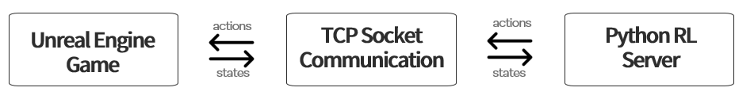
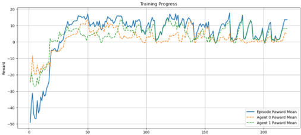
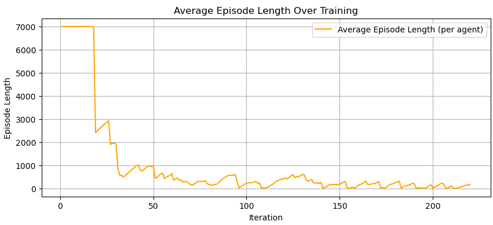

# Multi-Agent Reinforcement Learning in Unreal Engine 5

A multi-agent reinforcement learning project in which two NPCs learn autonomous behaviors through interaction in an Unreal Engine 5 environment.

The project connects an Unreal Engine game running on Windows with a Python reinforcement learning server running on WSL2. Two NPCs are independently controlled by PPO agents using RLlib and a custom PettingZoo Parallel Environment.

## Overview

The objective of this project was to develop a game environment in Unreal Engine and apply reinforcement learning so that multiple NPCs could learn and improve their behaviors autonomously through gameplay.

Two NPCs are placed on opposite sides of a map containing several obstacles.

Each NPC:

- Has 10 health points
- Can move independently
- Can fire at the opponent
- Is controlled by a separate reinforcement learning policy

An episode ends when either NPC loses all of its health or when the maximum number of steps is reached.

The environment was implemented using Unreal Engine Blueprint and C++.

## Tech Stack

### Game Environment

- Unreal Engine 5
- C++
- Blueprint

### Reinforcement Learning

- Python 3.10.12
- PyTorch 2.7.1
- Ray RLlib 2.5.0
- PPO
- PettingZoo 1.22.3
- Gymnasium 0.26.3
- NumPy 1.23.5
- psutil 7.0.0

### Environment

- Windows
- WSL2 Ubuntu
- CUDA GPU acceleration
- TCP socket communication
- JSON-based data exchange

## 1. Problem Description

The goal of this project was to investigate whether multiple NPCs could learn effective behaviors autonomously through reinforcement learning in an interactive game environment.

The game consists of two NPCs controlled independently by two reinforcement learning agents.

At the beginning of each episode, the NPCs are positioned at opposite ends of the map.

Several obstacles are placed throughout the environment to encourage more tactical interactions between the agents.

Each NPC has 10 health points, and the episode terminates when one NPC loses all health after being hit ten times.

The episode also terminates automatically after reaching a predefined maximum number of steps.

## 2. Methodology and Experimental Setup

### 2.1 Overall System Architecture

The system consists of two main components:

1. **Python RL Server**
   - Runs in WSL2 Ubuntu
   - Handles reinforcement learning logic
   - Manages model training
   - Receives game states
   - Sends agent actions

2. **Unreal Engine Game**
   - Runs natively on Windows
   - Provides the interactive 3D environment
   - Executes NPC actions
   - Handles game mechanics
   - Sends updated game states to Python

  

Communication between the two components is performed through TCP sockets.

Python sends action commands to Unreal Engine.

Unreal Engine returns information such as:

- NPC position
- NPC rotation
- Health
- Alive status

The game state is serialized as JSON and transmitted to the Python server.

### 2.2 Multi-Agent Reinforcement Learning Environment

PettingZoo was used as the multi-agent environment interface.

A custom **PettingZoo Parallel Environment** was implemented to connect the Python reinforcement learning system with Unreal Engine.

RLlib was used for training because of its support for distributed and multi-agent reinforcement learning.

The reinforcement learning algorithm used was:

**PPO (Proximal Policy Optimization)**

Each agent uses a separate policy.

### 2.3 Observation Space

Each agent receives a **16-dimensional observation vector**.

The observation contains information about both the agent itself and its opponent, including:

- 3D position
- Rotation
- Health
- Alive status

### 2.4 Action Space

Each agent has a discrete action space containing six actions.

| Action | Description |
|---|---|
| `FORWARD` | Move forward |
| `BACKWARD` | Move backward |
| `LEFT` | Move left |
| `RIGHT` | Move right |
| `STOP` | Take no movement action |
| `FIRE` | Fire at the opponent |

At every environment step, actions from both agents are sent to Unreal Engine.

The game executes those actions and returns the updated state to the Python environment.

### 2.5 Reward Function

The reward function was designed to encourage movement, interaction, and combat.

| Event | Reward |
|---|---:|
| Damage opponent | +11 per damage point |
| Kill opponent | +150 |
| Being killed | -20 |
| Move closer to opponent | Reward proportional to distance reduction |
| General movement | +0.005 per unit distance |
| No action | -0.05 |
| Survival | +0.001 per step |

The reward structure encouraged the agents to explore the environment, approach the opponent, and engage in combat.

### 2.6 Unreal Engine Implementation

The Unreal Engine side contains a TCP client implemented in C++.

The game handles:

- NPC movement
- Firing bullets
- Collision detection
- Health updates
- Death detection
- Episode termination

The TCP client receives action commands from Python and sends the updated game state back to the reinforcement learning server.

### 2.7 Training Logging and Checkpoints

The training system records several metrics during training:

- Mean episode reward
- Mean episode length
- Per-agent reward

The logs are stored in CSV files for later analysis.

Checkpoints are automatically saved every 100 training iterations.

The checkpoint restoration system allows training to continue from previously saved models.

### 2.8 Training Parameters

| Parameter | Value |
|---|---|
| Algorithm | PPO |
| Number of agents | 2 |
| Policies | Separate policy for each agent |
| Planned training iterations | 500 |
| Completed training iterations | 200 |
| Maximum steps | 7000 |
| PPO batch size | 4000 |
| SGD minibatch size | 128 |
| Gamma | 0.99 |
| Checkpoint interval | 100 iterations |

## 3. Results

### 3.1 Reward Improvement

During the early stages of training, the agents initially behaved randomly.

Rapid improvement was observed during approximately the first 50 training iterations.

After this stage:

- Mean episode rewards became positive
- Reward values became more stable
- Both agents showed consistent learning progress

Both agents achieved similar final reward levels.

  

### 3.2 Episode Length

At the beginning of training, episodes frequently reached the maximum length of approximately 7000 steps because the agents behaved inefficiently.

Episode length decreased sharply during the first 30 training iterations.

Afterward, episode lengths generally stabilized below 1000 steps.

This suggests that the agents learned to locate and engage their opponent more efficiently.

  

### 3.3 Emergent Agent Behaviors

Initially, both agents showed mostly random behavior and remained near their starting positions.

After several training iterations, the reward for movement and reducing the distance to the opponent encouraged the agents to explore the environment and approach each other.

Eventually, both agents learned that damaging and eliminating the opponent produced large rewards.

Around iteration 40, the two agents began to exhibit noticeably different behavioral strategies.

#### Agent 0 — Aggressive Behavior

Agent 0 developed a more aggressive strategy.

It tended to:

- Actively approach the opponent
- Accept the risk of being eliminated
- Prioritize closing distance
- Engage the opponent directly

#### Agent 1 — Defensive Behavior

Agent 1 developed a more defensive strategy.

It tended to:

- Wait for the opponent to approach
- Avoid unnecessary movement toward the opponent
- Counterattack when the opponent came closer

Although both agents showed similar reward trajectories, their learned behaviors were clearly different.

### 3.4 Final Performance

After approximately 200 training iterations, the final death counts were:

| Agent | Death Count |
|---|---:|
| Agent 0 | 94 |
| Agent 1 | 46 |

Agent 1 achieved nearly twice the survival performance of Agent 0.

Because both agents showed similar reward trajectories and Agent 0 did not exhibit inactivity or obviously failed learning, the result suggests that Agent 1's defensive strategy was more effective under the given reward structure and environment.

## 4. Discussion and Limitations

The experiment demonstrated that reinforcement learning can successfully optimize NPC behavior in a custom Unreal Engine environment.

The agents gradually transitioned from random behavior to more structured strategies involving:

- Exploration
- Approaching opponents
- Combat engagement
- Distinct behavioral strategies

One of the most interesting observations was that the two independently trained agents developed different behavioral tendencies despite operating in the same environment.

### Limited Perception

The current observation system directly provides game-state information to the reinforcement learning agents.

Ray casting could potentially improve the agents' perception by allowing them to determine:

- Whether they are facing the opponent
- Whether an obstacle is located in front of them

However, additional sensing would increase both the computational load on Unreal Engine and the amount of data transmitted through the TCP connection.

### Training Duration

Training was planned for 500 iterations but was conducted up to approximately 200 iterations.

Additional training could potentially result in more refined and sophisticated behaviors.

### Reward and Hyperparameter Tuning

The reward function strongly influenced the behaviors learned by the agents.

Further experiments with different reward functions and hyperparameter configurations could potentially improve agent performance and produce different strategies.

## 5. References

- [Ray RLlib](https://docs.ray.io/en/latest/rllib/)
- [PettingZoo](https://pettingzoo.farama.org/)
- [Unreal Engine](https://dev.epicgames.com/documentation/en-us/unreal-engine/)
